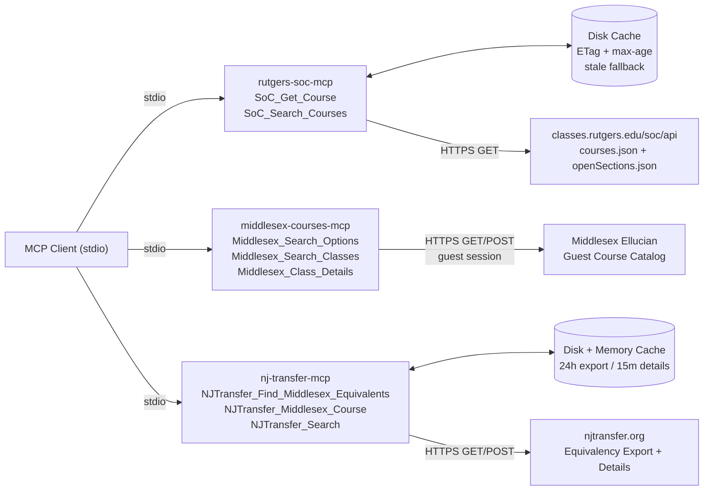

# Rutgers Catalog MCP

Three read-only, zero-authentication [Model Context Protocol (MCP)](https://modelcontextprotocol.io/) servers for querying public New Jersey higher-education course and transfer data:

- **`rutgers_soc`** (`rutgers-soc-mcp`) — Rutgers University Schedule of Classes (`classes.rutgers.edu/soc`)
- **`middlesex_courses`** (`middlesex-courses-mcp`) — Middlesex College guest course catalog (Ellucian Colleague Self-Service)
- **`nj_transfer`** (`nj-transfer-mcp`) — NJ Transfer course equivalencies from Middlesex College to Rutgers School of Engineering

Every server runs locally over `stdio`, requires no account or credentials, and returns structured JSON with retrieval timestamps, cache provenance, and official source links.

## Architecture



## Servers & Tools

| Server | Executable | Tool | Purpose |
| --- | --- | --- | --- |
| `rutgers_soc` | `rutgers-soc-mcp` | `SoC_Get_Course` | Exact Rutgers course lookup (`14:332:331`, `14332331`, or `332:331`), supplement variants, paginated sections, and live open-seat overlay |
| `rutgers_soc` | `rutgers-soc-mcp` | `SoC_Search_Courses` | Ranked search across Rutgers courses by title, code, subject, or description for any semester and campus |
| `middlesex_courses` | `middlesex-courses-mcp` | `Middlesex_Search_Options` | Lists current searchable terms, subjects, campuses/locations, academic levels, and course types |
| `middlesex_courses` | `middlesex-courses-mcp` | `Middlesex_Search_Classes` | Filtered live section search (term, subject, course/section number, days, times, location, online/open flags) with consistent pagination |
| `middlesex_courses` | `middlesex-courses-mcp` | `Middlesex_Class_Details` | Section-level prerequisites, corequisites, fees, meeting locations, instructors, and grading options by numeric `section_id` |
| `nj_transfer` | `nj-transfer-mcp` | `NJTransfer_Find_Middlesex_Equivalents` | Reverse lookup: finds active Middlesex College courses equivalent to a given Rutgers SOE course code, expanded with minimum grades, footnotes, and linked-course rules |
| `nj_transfer` | `nj-transfer-mcp` | `NJTransfer_Middlesex_Course` | Forward lookup: returns current (and optionally historical) Rutgers SOE evaluations for a Middlesex course ID, expanded with full details |
| `nj_transfer` | `nj-transfer-mcp` | `NJTransfer_Search` | Ranked search across current Middlesex-to-Rutgers-SOE evaluations by title, course code, or equivalency text |

## Caching, Freshness & Data Disclaimers

- **Rutgers Schedule of Classes (`classes.rutgers.edu/soc/api`)**
  - Caches `courses.json` (fallback TTL 15 min) and `openSections.json` (fallback TTL 30 s) atomically on disk, respecting upstream `Cache-Control: max-age` headers and revalidating with `If-None-Match` (`ETag`) conditional requests.
  - Validates response payloads before writing to cache; if an upstream request fails or returns a malformed payload, falls back to the last valid cache and sets `stale: true` while reporting separate `course_data` and `availability_data` provenance.
- **Middlesex College Guest Catalog (`middlesexcollege-ss.colleague.elluciancloud.com/Student/Courses`)**
  - Queried live on every call (not cached on disk) using a public guest session token with automatic session refresh on `400`/`403`.
  - Normalizes upstream 30-item pages into exact caller-requested `(page, limit)` slices so pagination never skips or duplicates sections.
- **NJ Transfer (`njtransfer.org/artweb/precs.cgi`)**
  - Caches the active equivalency export atomically on disk for 24 hours (with stale fallback on network failure) and caches per-evaluation detail lookups (minimum grade, footnote text, linked-course requirements) in memory for 15 minutes. Refreshing the export invalidates the in-memory detail cache.

Cache directories default to the platform user cache location (`platformdirs`) and can be overridden with `RUTGERS_SOC_CACHE_DIR` and `NJ_TRANSFER_CACHE_DIR`.

> **Disclaimers**
> - All three servers query publicly accessible institutional endpoints and are not affiliated with or endorsed by Rutgers University, Middlesex College, or NJ Transfer.
> - `nj_transfer` is scoped specifically to **Middlesex College -> Rutgers School of Engineering** evaluations.
> - Course offerings, open-seat counts, prerequisites, fees, and transfer evaluations can change at any time and are advisory only; they do not establish registration eligibility or transfer pre-approval.

## Quickstart

### Local setup with `uv`

Install [uv](https://docs.astral.sh/uv/getting-started/installation/), then clone and sync:

```bash
git clone https://github.com/ShachinRamkumar/rutgers-catalog-mcp.git
cd rutgers-catalog-mcp
uv sync --locked
```

Run any server directly over `stdio`:

```bash
uv run rutgers-soc-mcp
uv run middlesex-courses-mcp
uv run nj-transfer-mcp
```

### Registering with MCP clients

Use the included helper script to register all three local `stdio` servers with Codex and/or Claude Code (backing up existing client configs before writing):

```bash
uv run python scripts/configure_clients.py --client both
# Or target one client:
uv run python scripts/configure_clients.py --client codex
uv run python scripts/configure_clients.py --client claude
```

Or add the executables manually to any MCP host configuration (for example, `mcpServers` JSON):

```json
{
  "mcpServers": {
    "rutgers_soc": {
      "command": "/path/to/rutgers-catalog-mcp/.venv/bin/rutgers-soc-mcp"
    },
    "middlesex_courses": {
      "command": "/path/to/rutgers-catalog-mcp/.venv/bin/middlesex-courses-mcp"
    },
    "nj_transfer": {
      "command": "/path/to/rutgers-catalog-mcp/.venv/bin/nj-transfer-mcp"
    }
  }
}
```

### Running with Docker

Build the multi-stage container image (runs as a non-root `mcp` user with all three server executables installed):

```bash
docker build -t rutgers-catalog-mcp .
```

Run any of the three `stdio` servers:

```bash
docker run -i --rm rutgers-catalog-mcp                         # rutgers-soc-mcp (default)
docker run -i --rm rutgers-catalog-mcp middlesex-courses-mcp
docker run -i --rm rutgers-catalog-mcp nj-transfer-mcp
```

## Development & Verification

All automated unit and regression tests run completely offline using mocked HTTP transports and in-memory MCP clients:

```bash
uv sync --locked
uv run pytest
uv run ruff check src tests scripts
uv run ruff format --check src tests scripts
uv build
uv run python scripts/verify_package.py
```

`scripts/verify_package.py` verifies wheel/sdist archive cleanliness, installs the built wheel into an isolated temporary virtual environment, and checks tool discovery over `stdio` for all three installed executables. Pass `--live` to run explicit end-to-end checks against the live public endpoints.

GitHub Actions CI (`.github/workflows/ci.yml`) runs `pytest`, `ruff check`, `ruff format --check`, `uv build`, and `scripts/verify_package.py` across Linux, macOS, and Windows on Python 3.11 and 3.14, plus a Docker build and containerized MCP stdio smoke test for all three servers.

## License

MIT — see [LICENSE](LICENSE).
